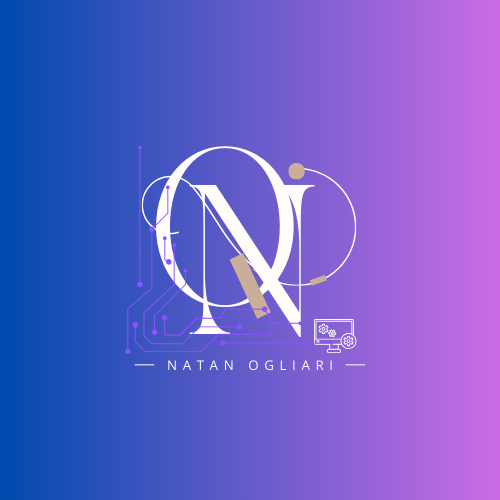

# Natan Ogliari

  

  <strong>Engenheiro de Software • Desenvolvedor Full Stack • Hardware & Automação</strong>

  
  
  

---

## Sobre mim

Sou Natan Ogliari, engenheiro de software com formação técnica em Eletroeletrônica e forte interesse em desenvolvimento de software, automação, hardware, IoT e sistemas personalizados.

Minha trajetória combina tecnologia, criatividade e vontade de resolver problemas reais com soluções práticas e escaláveis. Desde projetos acadêmicos até iniciativas de software personalizado e plataformas digitais, busco criar sistemas que unam funcionalidade, organização e impacto concreto.

---

## O que faço

- Desenvolvimento de software e aplicações web
- Automação e sistemas personalizados
- Integração com hardware e IoT
- Desenvolvimento back-end e front-end
- Criação de soluções voltadas à produtividade e ao uso prático

---

## Tecnologias

### Front-end
- HTML
- CSS
- JavaScript
- Tailwind CSS
- HTMX

### Back-end
- Python
- Django
- APIs REST
- Banco de dados relacionais

### Infra / Sistemas
- Linux
- Docker
- Customização de sistemas operacionais
- Automação de processos

### Hardware / IoT
- Eletrônica
- Sensores
- Automação
- Prototipagem de soluções

---

## Projetos em destaque

- [Servidor Linux Samba](https://github.com/OgliariNatan/servidor-file-samba4)
- [Fonte linear simétrica 5V](https://github.com/OgliariNatan/Fonte_Linear_simetrica_5V)
- [PIEVDCS](https://github.com/OgliariNatan/pievdcs)
- [Saracura Operating System Customization](https://github.com/OgliariNatan/saracura-operating-system-customization)
- [Template LaTeX para relatórios acadêmicos](https://github.com/ENGENHARIA-DE-SOFTWARE-UNOPAR/Template-UNOPAR)

---

## Portfólio

Acesse meu portfólio:
- [Portfólio pessoal](https://ogliarinatan.github.io)

---

## Currículo

Baixe meu currículo em PDF:
- [Download do currículo](./curriculo-natan-ogliari.pdf)

> Observação: para que o link funcione corretamente no GitHub Pages ou no GitHub, o arquivo PDF deve estar na raiz do repositório com o nome `curriculo-natan-ogliari.pdf`.

---

## Contato

Se você quiser conversar sobre projetos, oportunidades, colaborações ou desenvolvimento de soluções, pode me encontrar em:

- GitHub: [@OgliariNatan](https://github.com/OgliariNatan)
- LinkedIn: [Natan Ogliari](https://www.linkedin.com/in/natan-ogliari)
- E-mail: natanogliari@gmail.com

---

  
  

